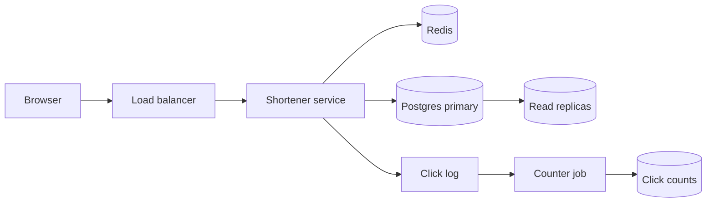

# Design a URL shortener

A URL shortener (TinyURL, bit.ly) is a read-heavy key-value service. A 7-character code maps to a long URL, redirects in a few milliseconds, and click counts are recorded off the request path.

## Requirements

**In scope**

- Create a short link from a long URL.
- Redirect `GET /{code}` to that URL.
- Optional custom alias and expiry.
- Per-link click counts.

**Out of scope for v1:** accounts, teams, and a full analytics dashboard. Those are extra columns and a second store, not a different architecture.

**Targets**

- Redirect under 10 ms on a cache hit, under 50 ms on a miss.
- Reads stay up if one database replica or one cache node dies.
- Codes are unique. Guessing the next code is not useful.

## Numbers

Assume 100 million new links a month and 100 reads per write.

| | Average | Peak (10×) |
| --- | ---: | ---: |
| Creates | ~40 / sec | ~400 / sec |
| Redirects | ~4,000 / sec | ~40,000 / sec |

Five years with no deletion is 6 billion rows. At about 500 bytes each (code, URL, expiry, owner), that is roughly 3 TB, about 6 TB with indexes. One Postgres primary with read replicas handles 400 writes per second. Shard later by the short code if writes grow 100×.

A 7-character base62 code (`0-9a-zA-Z`) has 62⁷ ≈ 3.5 trillion values. Six billion used codes are 0.2% of that space, so a random code collides on about 1 insert in 600. A unique primary key plus one retry covers that.

## API

```http
POST /v1/urls
{ "url": "https://example.com/a/b", "alias": "launch", "expire_at": "2026-12-01T00:00:00Z" }

201 { "short_url": "https://short.ly/aB3xY9k", "code": "aB3xY9k" }

GET /aB3xY9k          → 302 Location: https://example.com/a/b
GET /aB3xY9k          → 404 unknown, 410 expired
GET /v1/urls/aB3xY9k/stats → { "clicks": 184220 }
```

Use **302**, so every click reaches the service and can be counted. A 301 lets browsers and proxies cache the redirect and the count goes stale.

## Data model

One table, point lookup by primary key:

```text
links
  code        CHAR(7) PK
  long_url    VARCHAR(2048)
  expire_at   TIMESTAMP NULL
  created_at  TIMESTAMP
  user_id     BIGINT NULL
```

The redirect path never scans. An index on `user_id` exists only for "my links." Identical long URLs may get different codes. Deduping them saves little storage and surprises users who want a fresh link.

## Architecture



**Create**

1. Reject non-`http(s)` URLs and known phishing domains.
2. Custom alias: insert that code. Duplicate primary key returns 409.
3. Otherwise draw a random 7-character code and insert. On the rare collision, draw once more.
4. Return `https://short.ly/{code}`. Do not warm the cache. The creator is often not the reader.

**Redirect**

1. Look up `code` in Redis.
2. On a miss, read a replica, then fill Redis with a TTL. If the link expires, the TTL is the time left. Otherwise 24 hours.
3. If `expire_at` is past, return 410 and skip the cache fill.
4. Respond 302 and append `{code, time, country, referrer}` to the click log. The client does not wait for that write.

**Counts**

The redirect path never does `UPDATE clicks = clicks + 1`. A popular link would lock one row at tens of thousands of QPS. The counter job folds the log into per-code totals. Stats are a few seconds behind, which is the right trade for a dashboard.

## Cache

Forty thousand peak redirects per second should not all hit Postgres. Zipf traffic means a small hot set dominates. Cache about 50 million entries: code plus URL is roughly 10 GB, so a small Redis cluster with LRU eviction is enough.

Cache-aside: the app reads the cache, and only the app writes it after a database miss. A dead Redis node makes redirects slower, and the database still answers.

## If the interviewer pushes

**Codes must be unguessable and collision-free with no retry.** A key service pre-generates unique codes into a pool. Each app server pulls a batch of 10,000 into memory. At 400 writes per second a batch lasts about 25 seconds, so the key service is off the user path. When a server dies, its unused batch is discarded. The space is huge, so wasting a batch is fine.

**Writes go to 100,000 per second.** Shard Postgres by `hash(code)`. Creates and redirects for a code land on the same shard. Redis stays in front.

**Users are worldwide.** Put the shortener and Redis in each region. Replicas serve redirects locally. Creates go to the primary region. A code created in one region is readable in another within replica lag, usually under a second. The creator's own redirect can read the primary if the replica does not have the row yet.

**A link is reported as malware.** Set a disabled flag, delete the cache key, and return 410. The row stays for audit.

## Interview close

The design is a unique 7-character key, a cache in front of a replicated table, 302 so clicks are visible, and counts written asynchronously. At the stated load, one Postgres primary is enough. Sharding, a key-generation pool, and multi-region replicas are the upgrades once the numbers move.
